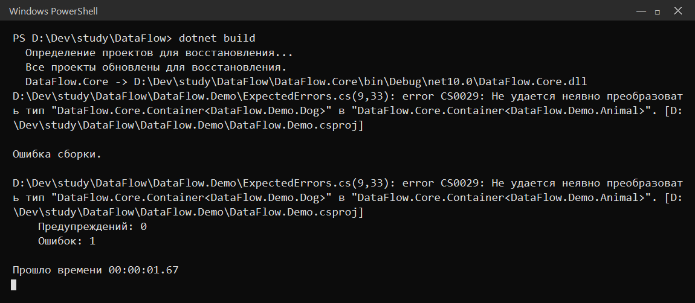
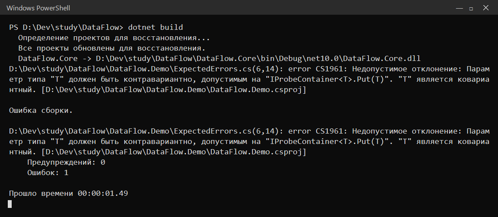
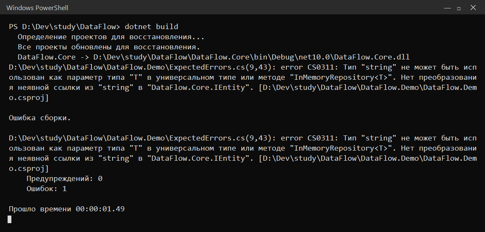

# DataFlow — небольшая обобщённая библиотека для однотипных данных

Отчёт по объёмному заданию КТ27–30 («Обобщения в C#»). Библиотека нужна затем, чтобы хранить и обрабатывать однотипные данные одной и той же реализацией, не дублируя код под каждый тип: буферы, записи с преобразованием, репозиторий с поиском по Id и методы расширения для любых перечисляемых коллекций.

## Что внутри

Решение из двух проектов:

- DataFlow.Core — сама библиотека: Buffer&lt;T&gt;, LabeledBuffer, GuardedBuffer&lt;T&gt;, Record&lt;T&gt;, делегат Mapper, интерфейсы IEntity/IRepository&lt;T&gt;/IContainer&lt;out T&gt;, InMemoryRepository&lt;T&gt;, Container&lt;T&gt; и методы расширения PrintAll/FindMax. Предметных типов здесь нет.
- DataFlow.Demo — консольное приложение: домен «Библиотека» (Book, Reader), иерархия Animal/Dog для проверки ковариантности и единый сценарий, который показывает все четыре блока.

## Как собрать и запустить

```
dotnet build
dotnet run --project DataFlow.Demo
```

Нужен .NET SDK 10. Сборка проходит с нулём ошибок и предупреждений. Полный вывод лежит в output.txt, он же вставлен в отчёт ниже текстом.

## Домен

Взял вариант 3, библиотека. Два типа:

- Book — книга: Id, Title, Year. Реализует IEntity (даёт Id для репозитория) и IComparable&lt;Book&gt;: CompareTo сравнивает по году издания. Поэтому FindMax по каталогу книг возвращает самую новую, а не самую дорогую или ещё какую-то.
- Reader — читатель: Id, Name, Ticket. Реализует только IEntity: ему не нужно сравниваться, он живёт в репозитории и всё.

Отдельно есть Animal и Dog — простая иерархия без обобщений, нужна только для демонстрации ковариантности IContainer&lt;out T&gt;.

## Схема

```mermaid
classDiagram
    class Buffer~T~ {
        #List~T~ items
        +int Count
        +bool TryAdd(T item)
    }
    class LabeledBuffer {
        +void PrintAllUpper()
    }
    class GuardedBuffer~T~ {
        -Func~T,bool~ filter
        +int AcceptedCount
        +bool TryAdd(T item)
    }
    Buffer~T~ <|-- LabeledBuffer
    Buffer~T~ <|-- GuardedBuffer~T~
    LabeledBuffer : T = string (зафиксирован)

    class IEntity {
        <<interface>>
        +int Id
    }
    class IRepository~T~ {
        <<interface>>
        +int Count
        +void Add(T item)
        +T GetById(int id)
    }
    class IContainer~T~ {
        <<interface>>
        +T GetItem()
    }
    class InMemoryRepository~T~ {
        -List~T~ items
        +void Add(T item)
        +T GetById(int id)
    }
    class Container~T~ {
        -T item
        +T GetItem()
    }
    IRepository~T~ <|.. InMemoryRepository~T~
    IContainer~T~ <|.. Container~T~
    IRepository~T~ : where T : IEntity
    IContainer~T~ : out T

    class Record~T~ {
        <<struct>>
        +T Value
        +string Label
    }
    class Mapper~T,TResult~ {
        <<delegate>>
    }
    class Book {
        +int Id
        +string Title
        +int Year
        +int CompareTo(Book other)
    }
    class Reader {
        +int Id
        +string Name
        +string Ticket
    }
    IEntity <|.. Book
    IEntity <|.. Reader
    IComparable~Book~ <|.. Book
```

Где параметр типа фиксируется, а где остаётся открытым: в LabeledBuffer он зафиксирован как string, в GuardedBuffer&lt;T&gt;, Record&lt;T&gt;, InMemoryRepository&lt;T&gt; и Container&lt;T&gt; остаётся открытым. В IContainer&lt;T&gt; он ковариантный (out), в IRepository&lt;T&gt; — инвариантный с ограничением where T : IEntity.

## Разбор по шагам

### Шаг 0. Решение и два проекта

1. Два проекта нужны, чтобы отделить переиспользуемую библиотеку от демонстрации. Ядро ничего не знает про книги и читателей, его можно подключить к другому приложению. Если всё свалить в один проект, библиотека перестаёт быть библиотекой, и по критериям это минус.
2. Без dotnet add reference демонстрация не увидит типы ядра. Проекты в решении — просто соседи, ссылку между ними надо добавлять руками, иначе компилятор скажет, что Buffer не найден.
3. У библиотеки нет метода Main, запускать нечего. Консольный проект точку входа содержит, поэтому его и можно запустить через dotnet run.

### Шаг 1. Buffer&lt;T&gt;

1. private виден только внутри класса, public — всем, protected — классу и его наследникам. Для items нужен именно protected: LabeledBuffer читает список в foreach, а снаружи менять его нельзя.
2. readonly запрещает переприсвоить поле, то есть второй раз написать items = new List&lt;T&gt;(). Добавлять элементы это не мешает: сам объект списка остаётся тем же.
3. Сейчас TryAdd всегда возвращает true, но в GuardedBuffer он вернёт false при отказе. bool — часть контракта: метод сообщает результат, не бросая исключение. Префикс Try как раз про это.
4. Без virtual переопределить метод в GuardedBuffer нельзя, компилятор выдаст ошибку. Можно спрятать его через new, но тогда вызов через переменную базового типа пойдёт в базовую версию, и фильтр работать не будет.
5. new() — это target-typed new: тип берётся из объявления поля. new List&lt;T&gt;() — то же самое, но тип написан явно. Разницы в результате нет, только в длине записи.

### Шаг 2. LabeledBuffer

1. LabeledBuffer : Buffer&lt;string&gt; фиксирует T, и класс перестаёт быть обобщённым. GuardedBuffer&lt;T&gt; : Buffer&lt;T&gt; оставляет T открытым и остаётся обобщённым. Первый — специализация под строки, второй — расширение поведения для любого типа.
2. В Buffer&lt;T&gt; компилятор не знает, что такое T, у него нет метода ToUpper. ToUpper есть только у string, поэтому PrintAllUpper можно написать лишь после фиксации T = string.
3. LabeledBuffer&lt;int&gt; не скомпилируется: LabeledBuffer не обобщённый, параметра типа у него нет. Он уже наследует Buffer&lt;string&gt;.
4. От Buffer&lt;object&gt; числа хранить смог бы: int упаковался бы в object. Но PrintAllUpper пришлось бы делать с проверкой типа и приведением, а в буфер строк можно было бы случайно положить что угодно. Ошибка вылезла бы в рантайме, типовой безопасности нет.

### Шаг 3. GuardedBuffer&lt;T&gt;

1. Проверка отказа стоит до вызова базы, чтобы отклонённый элемент вообще не попал в список. Если сначала добавить, а потом проверять, придётся удалять, а это лишняя логика и лишний шанс ошибиться.
2. Если увеличивать AcceptedCount до проверки результата базы, счётчик будет расти и на отклонённых элементах. Условие if (added) гарантирует, что считаются только реально принятые.
3. Код класса один, но T подставляется разный: для int работает x > 0, для string — проверка на пустоту. Правило приходит делегатом, поэтому поведение зависит от T и лямбды, а не от текста класса.
4. items.Add(item) дублирует логику базового класса. Если в Buffer&lt;T&gt; однажды появятся свои проверки, GuardedBuffer их пропустит. base.TryAdd переиспользует базу и возвращает её результат.
5. Если зашить условие внутрь, класс перестанет быть универсальным: для int и string понадобятся разные версии или ветвления по типу. Делегат в конструкторе оставляет решение вызывающему коду.

### Шаг 4. Record&lt;T&gt;, Mapper и Map

1. struct — значимый тип: при передаче копируется, изменения оригинала не видны, null по умолчанию не бывает. class — ссылочный: передаётся ссылка, может быть null, изменения видны всем.
2. Без ToString() вывод будет DataFlow.Core.Record`1[System.Decimal] — имя типа вместе с аргументом. С переопределением получается «Цена: 1200».
3. Компилятор смотрит на тип возвращаемого значения лямбды: (decimal p) => p >= 1000m ? "дорогая" : "дешёвая" возвращает string, значит TResult = string. T выводится из Record&lt;decimal&gt;.
4. ToFahrenheit и ToCategory — два метода под конкретные преобразования, их пришлось бы писать под каждую пару типов. Map один: он принимает делегат и вызывает его, а T и TResult выводятся на месте вызова.
5. Да, увидит: в выводе вместо «Цена: 1200» будет имя типа. Это заметно и в выводе программы, и в отчёте, поэтому проверяющий сразу поймёт, что ToString не переопределён.

### Шаг 5. Контракты

1. Без where T : IEntity компилятор не даст обратиться к item.Id: он не знает, что у T есть Id. Тело Add и GetById просто не скомпилируется.
2. Ограничение — часть типа, оно проверяется при компиляции, когда известны все подстановки. В рантайме проверять уже нечего: неподходящий тип просто не собрался бы.
3. T? для ссылочного T означает «возможно null». Nullable&lt;T&gt; — отдельная структура только для значимых типов (int?). Для обобщённого T без ограничения T? — это аннотация «может быть null», а не Nullable&lt;T&gt;.
4. Компилятор выдаст CS1961: параметр out T нельзя использовать в позиции входа. Ковариантность разрешает только возвращать T, а Put его принимает, то есть обещание нарушается.

### Шаг 6. InMemoryRepository&lt;T&gt;

1. Интерфейс обещает, что T — IEntity. Реализация обязана повторить ограничение, иначе компилятор не даст ей обращаться к item.Id и не подтвердит контракт. Проверка идёт на этапе компиляции для каждой реализации.
2. Для ссылочного типа default — это null, для int — 0. Поэтому GetById(99) у книг вернёт null, а если бы репозиторий был над int, вернул бы 0.
3. Компилятор выдаст CS0403: null нельзя преобразовать в T, потому что T может быть структурой. Нужно default (или default(T)).
4. В Buffer&lt;T&gt; items нужен наследникам, поэтому protected. В репозитории список — деталь реализации, наследников нет, снаружи он не нужен, поэтому private.

### Шаг 7. Container&lt;T&gt; и ковариантность

1. IContainer&lt;out T&gt; ковариантен: Container&lt;Dog&gt; можно использовать как IContainer&lt;Animal&gt;, потому что T только возвращается наружу, и Dog безопасно выдать за Animal. Container&lt;T&gt; — класс, по умолчанию инвариантен: Container&lt;Dog&gt; и Container&lt;Animal&gt; для компилятора разные типы.
2. Цена — T нельзя принимать в методах. Поэтому в IContainer нет Put. Если бы он понадобился, out пришлось бы убрать.
3. sealed запрещает наследникам добавить, например, Put(T). Тогда через переменную IContainer&lt;Animal&gt;, которая смотрит на Container&lt;Dog&gt;, можно было бы положить Animal, а внутри оказался бы Dog. sealed держит гарантию ковариантности.
4. Например, метод, который принимает IContainer&lt;Animal&gt; и просто читает животное: ему можно передать IContainer&lt;Dog&gt;, IContainer&lt;Cat&gt; и любой другой контейнер. С Container&lt;Animal&gt; пришлось бы создавать контейнер именно с Animal.

### Шаг 8. Методы расширения

1. С List&lt;T&gt; метод перестанет работать для массивов, результатов Where/Select, HashSet и прочих перечисляемых. IEnumerable&lt;T&gt; покрывает всё, что можно перебрать, поэтому выбран он.
2. Без where T : IComparable&lt;T&gt; компилятор не знает, что у T есть CompareTo, и вызов item.CompareTo(best!) не соберётся. Ограничение и есть разрешение на этот вызов.
3. Max() на пустой последовательности бросает InvalidOperationException, а по заданию FindMax не должен бросать, он возвращает default. Поэтому ручной проход с флагом found.
4. return null для обобщённого T не скомпилируется (CS0403), потому что T может быть структурой. return default работает всегда: null для ссылок, 0 для int. В выводе это видно: пустой List&lt;string&gt; даёт null, пустой List&lt;int&gt; — 0.
5. best! — оператор подавления nullable-предупреждения. Я обещаю компилятору, что best не null: связь с found он не видит. Без него будет предупреждение, а сборка должна быть без предупреждений.

### Шаг 9. Домен

1. Book перестанет реализовывать IEntity: не будет Id, репозиторий не сможет искать по Id, а where T : IEntity не пропустит Book. Компиляция сломается.
2. CompareTo(Book?) обязан уметь сравнивать с null: null может прийти, и интерфейс это допускает. В реализации null считается меньшим, поэтому возвращается 1.
3. Если всегда возвращать 1, CompareTo будет говорить, что любой элемент больше любого другого. Сортировка станет непредсказуемой, FindMax может вернуть не максимум. Правило знака нарушается.
4. PrintAll выведет DataFlow.Demo.Book вместо «Мастер и Маргарита (1967)»: ToString по умолчанию даёт имя типа. Читать вывод станет невозможно.
5. Reader не участвует в сравнении, ему достаточно IEntity для репозитория. Book сравнивается по году, потому что FindMax по каталогу книг имеет смысл. IComparable подключается только там, где нужен.

### Шаг 10. Единый сценарий

1. Кодировку надо выставить до первого вывода. Если поставить после, первые строки уже уйдут в старой кодировке и превратятся в кракозябры. В Windows консоль по умолчанию не UTF-8.
2. Один и тот же GuardedBuffer&lt;T&gt; работает и с Book, и с Reader: разные T, разные лямбды, а класс один. Если бы он был заточен под строку, Book бы не собрался.
3. Строка «Счётчики независимы: modern.AcceptedCount = 2, readers.AcceptedCount = 1». Два экземпляра одного класса имеют разные значения счётчика, значит AcceptedCount — поле экземпляра, а не статическое.
4. Строка «decimal → string: Категория: дорогая». Один и тот же Map&lt;T, TResult&gt; в первом вызове вернул Record&lt;decimal&gt;, во втором — Record&lt;string&gt;. Тип результата задаёт лямбда, сигнатура метода не меняется.
5. «FindMax на пустом List&lt;int&gt; = 0»: для int default равен 0, исключения нет. Это не ошибка, а следствие default(T). Для List&lt;string&gt; там null — тоже default.

### Шаг 11. Три ожидаемые ошибки

1. Container&lt;T&gt; инвариантен, поэтому Container&lt;Dog&gt; не превращается в Container&lt;Animal&gt;. Интерфейс IContainer&lt;out T&gt; ковариантен, и через него это разрешено. Ошибка именно про класс.
2. С in T параметр можно только принимать. Тогда Put(T) станет допустим, а GetItem() с возвратом T — нет: CS1961 появится уже на GetItem. Ковариантность и контравариантность в одном параметре не совмещаются.
3. Любой тип, не реализующий IEntity: string, int, List&lt;int&gt;, Book без IEntity и так далее. Компилятор проверит where T : IEntity и не пропустит.
4. Все три правила — инвариантность класса, вариативность интерфейса и ограничение типа — проверяются на этапе компиляции, когда известны типы. От данных они не зависят, поэтому ловятся до запуска.
5. Ошибка на компиляции дешевле: код не попадёт в релиз, её видно сразу, и она не требует тестов на рантайме. Ошибка в рантайме может дойти до пользователя и стоит дороже.

### Шаг 12. Финальная сборка

Собрал в Release, прогнал сценарий, проверил, что в ядре нет имён предметных типов:

```
dotnet build --configuration Release
grep -r "Book\|Reader" DataFlow.Core/
```

grep ничего не нашёл — ядро чистое. Проект собирается с нулём ошибок и предупреждений.

## Вывод программы

```
=== Блок A: иерархии обобщённых классов ===
МАСТЕР И МАРГАРИТА
ВОЙНА И МИР
ПИКНИК НА ОБОЧИНЕ
LabeledBuffer.Count = 3

--- GuardedBuffer<Book>: только книги после 1950 года ---
Добавлено: Мастер и Маргарита (1967)
TryAdd(Мастер и Маргарита) = True
Отклонено: Война и мир (1869)
TryAdd(Война и мир) = False
Count = 1, AcceptedCount = 1 — после отказа
Добавлено: Пикник на обочине (1972)
TryAdd(Пикник на обочине) = True
Count = 2, AcceptedCount = 2

--- GuardedBuffer<Reader>: только с непустым билетом ---
Добавлено: Алина, билет T-001
TryAdd(Алина) = True
Отклонено: Борис, билет  
TryAdd(Борис) = False
Count = 1, AcceptedCount = 1
Счётчики независимы: modern.AcceptedCount = 2, readers.AcceptedCount = 1

=== Блок B: обобщённая структура, делегат и метод ===
Исходная запись: Цена: 1200
decimal → decimal: Со скидкой: 1080,0
decimal → string: Категория: дорогая
Исходная запись: Год: 1967
int → int: Возраст книги: 59
int → bool: Современная: False

=== Блок C: обобщённые интерфейсы ===
GetById(2) = Война и мир
GetById(99) = null
GetById(1) у читателей = Алина
Счётчики независимы: books.Count = 2, readersRepo.Count = 1
IContainer<Animal>.GetItem() = Dog по имени Шарик

=== Блок D: методы расширения ===
FindMax на List<int> = 9
FindMax на пустом List<string> = null
FindMax на пустом List<int> = 0
FindMax на List<Book> = Пикник на обочине
Элемент: 5
Элемент: 9
Элемент: 2
Книга: Мастер и Маргарита (1967)
Книга: Война и мир (1869)
Книга: Пикник на обочине (1972)
(пустой список ничего не напечатал)
```

## Три ошибки компиляции

Все три фрагмента лежат в DataFlow.Demo/ExpectedErrors.cs закомментированными, чтобы проект собирался. Для скриншота я раскомментировал один блок, собрал, снял сообщение и вернул обратно. Тексты ошибок и скриншоты — ниже.

### CS0029 — инвариантность класса



Container&lt;Animal&gt; box = new Container&lt;Dog&gt;(...); — компилятор не может неявно преобразовать Container&lt;Dog&gt; в Container&lt;Animal&gt;. Обобщённый класс инвариантен: для него это разные типы, и он не знает, безопасна ли подстановка. Через IContainer&lt;out T&gt; та же операция проходит, потому что интерфейс ковариантный.

### CS1961 — нарушение ковариантности



В IProbeContainer&lt;out T&gt; добавил void Put(T item). out T — обещание, что T используется только на выходе, а Put принимает его на входе. Компилятор отказывается: параметр типа не может быть ковариантным в позиции входа. Для такого метода нужен in T, но тогда нельзя будет возвращать T.

### CS0311 — нарушение ограничения



new InMemoryRepository&lt;string&gt;() не компилируется: string не реализует IEntity и не подходит под where T : IEntity. Ограничение проверяется при компиляции, поэтому неподходящий тип просто нельзя подставить.

## Что осталось и что бы сделал иначе

Отдельного хранения в файл или базы нет: репозиторий в памяти, этого хватало по заданию. Тестов тоже нет, проверял запуском и глазами по выводу.

Во второй раз я бы, наверное, вынес фильтры GuardedBuffer в именованные методы, а не писал лямбды прямо в Program.cs: в сценарии они короткие, но если фильтров станет больше, читать будет тяжелее. Ещё добавил бы третий тип домена, чтобы репозиторий и FindMax проверить на чём-то кроме книг. И, пожалуй, завёл бы отдельную ветку под эксперименты с in/out — пару раз приходилось откатывать файлы, ветка была бы удобнее.

## История коммитов

```
f7890c5 13.11 16:40 Шаг 11: три ожидаемые ошибки компиляции
349019a 12.11 19:10 Шаг 10: единый сценарий A-D
5e72285 12.11 18:00 Шаг 9: типы домена с IEntity и IComparable<Book>
13cadc9 12.11 17:15 Шаг 8: PrintAll и FindMax как методы расширения
9baeda6 11.11 19:30 Шаг 7: Container<T> и проверка ковариантности
7cf3f9b 11.11 18:45 Шаг 6: InMemoryRepository<T> с поиском по Id
bf4cf45 11.11 18:05 Шаг 5: контракты IEntity, IRepository<T>, IContainer<out T>
066b6b1 11.11 17:20 Шаг 4: Record<T>, делегат Mapper и обобщённый Map
b392d9f 10.11 20:10 Шаг 3: GuardedBuffer<T> переопределяет TryAdd
12a4b0e 10.11 19:15 Шаг 2: LabeledBuffer фиксирует T = string
3c74434 10.11 18:40 Шаг 1: базовый обобщённый класс Buffer<T>
9d0eb80 10.11 18:05 Шаг 0: пустое решение с двумя проектами
```

Шаг 12 — отдельный коммит, в него уже входит этот отчёт.
